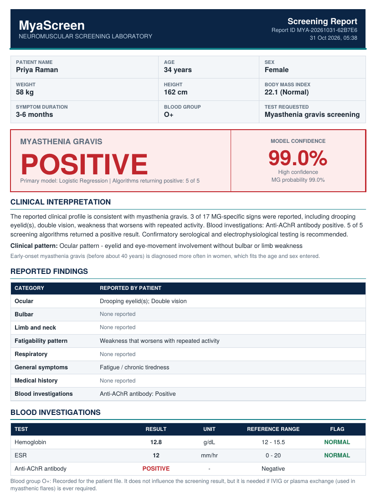
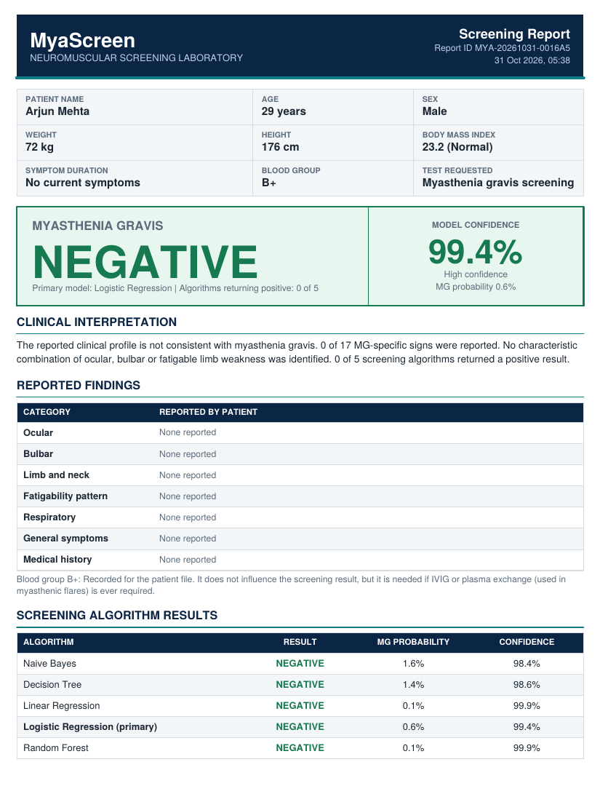
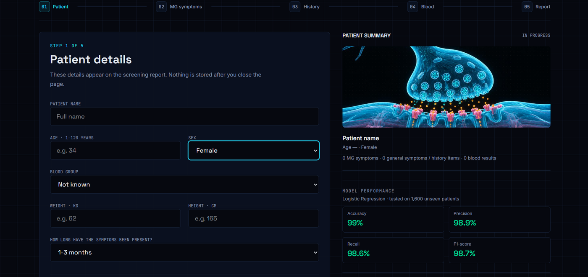
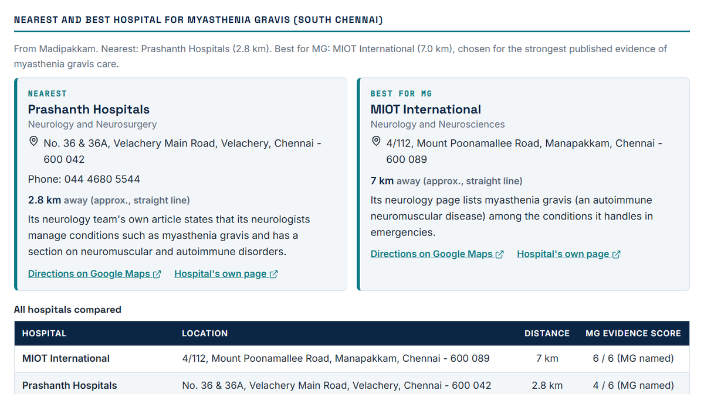
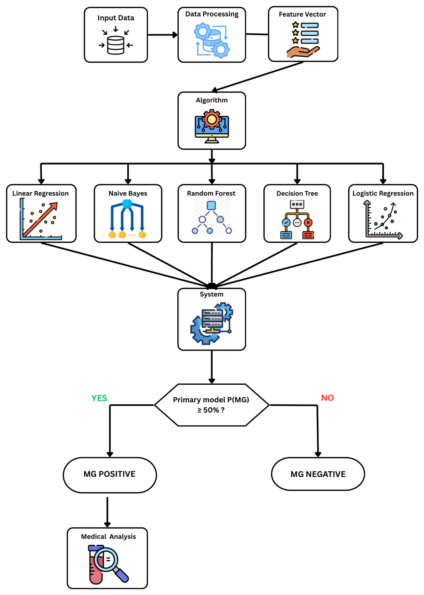
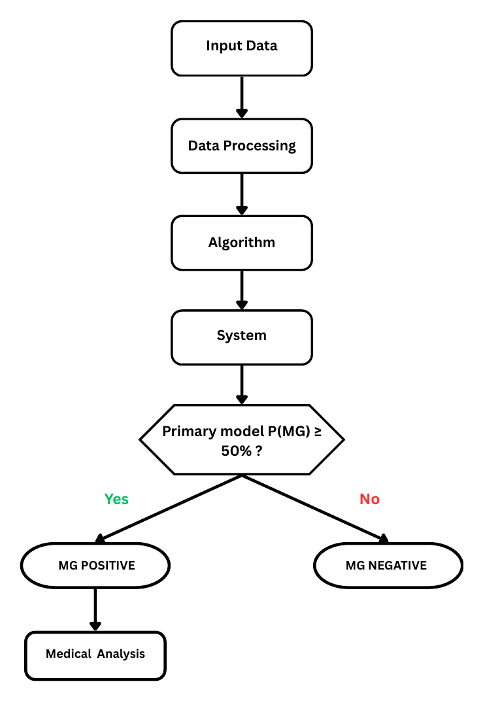
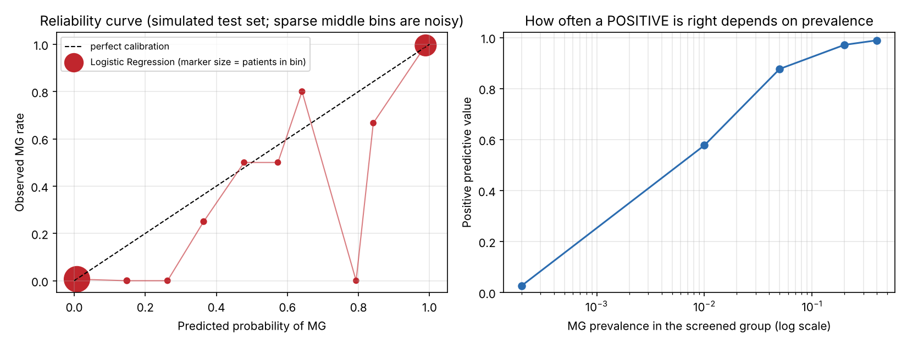

# MyaScreen

**A technical demo of a symptom-based screening aid for myasthenia gravis (MG): five machine-learning models, calibrated probabilities, a medical-style PDF report and a South Chennai hospital finder.**


> **Not a medical device.** MyaScreen is a research and learning prototype. It is trained on a **simulated** patient cohort, has **never been validated on real patients**, and must not be used to diagnose, rule out or treat any condition. A NEGATIVE result does not exclude myasthenia gravis. There is no public symptom-level MG dataset, so the performance numbers below describe the simulation, not the real world. See [Results](#results) and [Limitations](#limitations).

<p align="center">
  
  
</p>
<p align="center"><sub>Sample reports for fictional patients. The same report is shown in the app and downloadable as a PDF (<a href="docs/sample-report-positive.pdf">positive</a>, <a href="docs/sample-report-negative.pdf">negative</a>).</sub></p>

## Why this exists

Early myasthenia gravis looks like fatigue, thyroid eye disease or other autoimmune conditions, so patients often see several clinicians before it is suspected. Most published ML work on MG targets prognosis or needs hospital-only inputs (CT scans, serum spectroscopy, facial video). MyaScreen asks a different question: **what can be said from only what a patient or front-line clinician can supply** (symptoms, history and optional routine blood results), and how can that be turned into a clear, honest report a patient can carry to a doctor?

## App tour

<p align="center">
  
  
</p>
<p align="center"><sub>Step 1 of the guided form (left) and the hospital finder at the end of the report (right).</sub></p>

## Features

- **Guided 5-step intake**: patient details, 17 MG-specific signs, 13 general symptoms, 5 history items, optional blood values and antibody status, with a live patient summary.
- **47-value feature vector** built from the answers, with sex-specific reference ranges that turn blood values into Low / Normal / High flags.
- **Five algorithms compared under one protocol**: Gaussian Naive Bayes, Decision Tree, Linear Regression (as a linear probability model), Logistic Regression and Random Forest.
- **Calibrated probabilities** using Platt scaling on out-of-fold scores, so "93%" is a probability and not just a raw score.
- **Transparent decision rule**: the primary model is chosen automatically by cross-validated ROC-AUC (never the test set) and decides POSITIVE or NEGATIVE at P(MG) >= 50%. The other four are shown for comparison and do not vote.
- **Medical-style report** on screen and as a **PDF** (ReportLab): verdict, confidence, findings, blood table, per-model results, recommended investigations, specialists, day-to-day advice and medication-safety notes (rule-based, not learned).
- **Safety alert** for breathing or swallowing difficulty, shown before any model runs.
- **South Chennai hospital finder**: nearest hospital and best-evidenced hospital for MG from seven real hospitals, using a documented scoring rule. It runs after the prediction and never changes it ([details](HOSPITALS.md)).
- **CLI** for quick reports without the web app.

## How it works

<p align="center"> &nbsp; </p>

1. The form sends the answers as one JSON request to `POST /predict`.
2. The Flask API validates the input (unknown keys or out-of-range values return HTTP 400) and builds the 47-value feature vector.
3. All five trained models score the same vector; Platt scaling turns each score into P(MG).
4. The primary model (highest cross-validated ROC-AUC, Logistic Regression in the shipped bundle) decides at 50%.
5. The report is assembled; a POSITIVE adds investigations, specialists and safety notes from a rule-based knowledge base, a NEGATIVE adds a watch-list.
6. If a South Chennai area or GPS position was given, the hospital finder adds the nearest and best hospital. `POST /report-pdf` renders the same report as a PDF.

More detail: [docs/ARCHITECTURE.md](docs/ARCHITECTURE.md).

## Results

All numbers come from a **simulated** cohort of 8,000 patients (40% with MG, built from published clinical frequencies, seed 42) and a stratified 1,600-patient test set. They show how consistent the models are with that simulation. They are **not** estimates of clinical accuracy.

| Algorithm | Accuracy | Sensitivity | Specificity | ROC-AUC |
|---|---|---|---|---|
| Naive Bayes | 95.9% | 97.2% | 95.1% | 0.993 |
| Decision Tree | 95.2% | 93.6% | 96.4% | 0.984 |
| Linear Regression | 97.9% | 96.4% | 99.0% | 0.994 |
| **Logistic Regression (primary)** | **99.0%** | **98.6%** | **99.3%** | **0.997** |
| Random Forest | 98.1% | 97.5% | 98.4% | 0.996 |

95% bootstrap intervals for every number are in [docs/EVALUATION.md](docs/EVALUATION.md) (for the primary model, accuracy 98.5% to 99.4%). Those intervals only cover sampling error on one simulated test set.

Because the simulation separates the classes cleanly, high scores are expected. The checks that matter more are these ([full tables](docs/EVALUATION.md), regenerate with `python evaluate_honest.py`):

- **Rare disease, many false alarms.** MG is rare (roughly 10 to 20 per 100,000 people). At the primary model's sensitivity and specificity, a POSITIVE is right about 2.6% of the time in the general population, 58% of the time when 1% of the screened group has MG, and 88% when 5% do. The tool only makes sense for people who already have suspicious symptoms.
- **Sensitivity differs by MG form.** Ocular-only MG, the hardest form, is detected less often (96.6%) than generalized (99.0%) or bulbar-predominant (99.2%). Lambert-Eaton syndrome is the weakest look-alike (92.9% specificity).
- **Noisy answers hurt.** If 10% of the yes/no answers are flipped at random, accuracy falls from 99.0% to 87.9%; at 20%, to 73.1%.
- **Probabilities are calibrated on simulated data only**, so a displayed "93%" is only meaningful for patients who resemble that data.

<p align="center"></p>

The real test is a prospective or retrospective study on de-identified clinical records from the intended population, which this project does not have.

## Quick start

You need Python 3.10+ and, for the web UI, Node.js 20+ (or Bun).

**1. Backend (Flask API on http://127.0.0.1:5000)**

```bash
cd backend/mg_predictor
pip install -r requirements.txt
python api.py
```

The API listens on localhost only because it has no authentication; set `MYASCREEN_HOST=0.0.0.0` if you really need to expose it. Or run `./start-backend.sh` (macOS/Linux) / `start-backend.bat` (Windows) from the repository root. The trained model bundle and dataset are included. If the bundle cannot be loaded, the API regenerates the data and retrains automatically.

**2. Frontend (open the URL that Vite prints)**

```bash
npm install        # or: bun install
npm run dev
```

The UI talks to `http://127.0.0.1:5000` by default; set `VITE_API_URL` to point elsewhere.

**3. Command line (no web app needed)**

```bash
cd backend/mg_predictor
python predict_cli.py --name "Priya Raman" --age 34 --gender female --weight 58 --height 162 \
    --red-flags droopy_eyelids,double_vision,fatigable_weakness --symptoms fatigue \
    --blood-group O+ --blood hemoglobin=12.8,esr=12 --achr positive --pdf report.pdf
python predict_cli.py --list     # every valid symptom key
```

**Retrain from scratch**

```bash
python generate_dataset.py   # rebuilds data/mg_screening_dataset.csv (seed 42)
python train.py              # trains and calibrates 5 models, writes models/ and outputs/
python evaluate_honest.py    # confidence intervals, calibration, PPV at realistic prevalence, robustness
```

## API

| Endpoint | Purpose |
|---|---|
| `POST /predict` | Full screening report as JSON |
| `POST /report-pdf` | The same report as a PDF |
| `GET /options` | Symptom, history, blood-test and area definitions for the form |
| `GET /hospitals`, `GET /hospital-areas` | Hospital finder data |
| `GET /metrics`, `/dataset-breakdown`, `/learning-curve`, `/health` | Model and dataset information |

```bash
curl -X POST http://127.0.0.1:5000/report-pdf -H "Content-Type: application/json" -o report.pdf \
  -d '{"name":"Priya Raman","age":34,"gender":"female","weight_kg":58,"height_cm":162,
       "duration_months":4.5,"blood_group":"O+","blood_tests":{"hemoglobin":12.8,"esr":12},
       "antibodies":{"achr":"positive"},"symptoms":["fatigue"],
       "red_flags":["droopy_eyelids","double_vision"]}'
```

Field reference and design notes are in [backend/mg_predictor/README.md](backend/mg_predictor/README.md).

## Tests

```bash
cd backend/mg_predictor
python -m unittest discover -s tests -v     # 34 tests: data, models, validation, blood flags, emergency alert, PDF, hospital finder, API, evaluation maths
npm test                                    # front-end tests (Vitest)
```

One test checks that the symptom lists in the backend (`mg/config.py`) and the front end (`src/lib/mg-options.ts`) never drift apart; another checks that adding a location never changes the prediction.

## Project layout

```
backend/mg_predictor/
  api.py               Flask REST API
  train.py             training, calibration, evaluation, charts
  generate_dataset.py  builds the simulated cohort
  evaluate_honest.py   intervals, calibration, prevalence and robustness checks
  predict_cli.py       command-line reports
  mg/                  config, data, models, predictor, knowledge base, PDF, hospitals
  tests/               backend tests
src/                   React + TanStack Start front end (form, report view, charts)
docs/                  architecture notes, diagrams, screenshots, sample reports
HOSPITALS.md           hospital finder data, sources and ranking rule
```

## Limitations

- **The data is simulated.** No real patient records were used, so reported scores reflect the simulation, and the probabilities are calibrated on simulated data only.
- **One split, one seed**, reported as point estimates without confidence intervals.
- **The hospital finder** uses information from the hospitals' own websites (checked October 2026). Distances are straight-line estimates and coordinates are approximate. "Best" is a transparent evidence score, not a clinical outcome ranking. Always phone the hospital first.
- **No authentication or encryption and nothing is stored.** Do not enter real patient data into a public deployment.
- The pickled model bundle (`models/mg_bundle.joblib`) should only be loaded from a source you trust.

## Roadmap

- [ ] Validate on real, de-identified clinical data (the main missing piece)
- [ ] Per-patient explanations (which answers moved the result most)
- [ ] Optional objective inputs such as eyelid photographs or voice recordings
- [ ] Road-distance routing, opening hours and more hospitals beyond South Chennai
- [ ] Containerised, access-controlled deployment

## Contributing

Issues and pull requests are welcome. Please run the backend tests before opening a pull request, and keep the backend and front-end symptom lists in sync (the tests will tell you if they are not). If you change the API response, update both `backend/mg_predictor/mg/predictor.py` and `src/lib/mg-api.ts`.

## License

[MIT](LICENSE). The hospital information belongs to the respective hospitals and is cited from their own websites.
