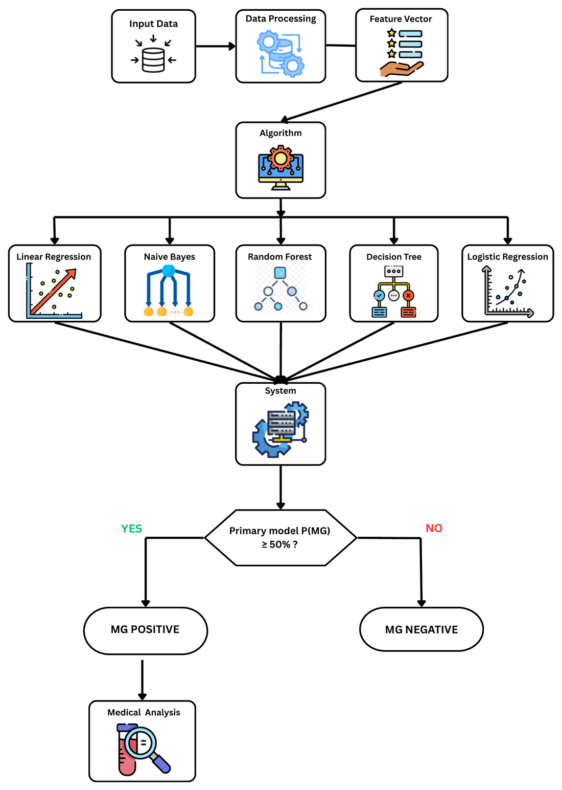
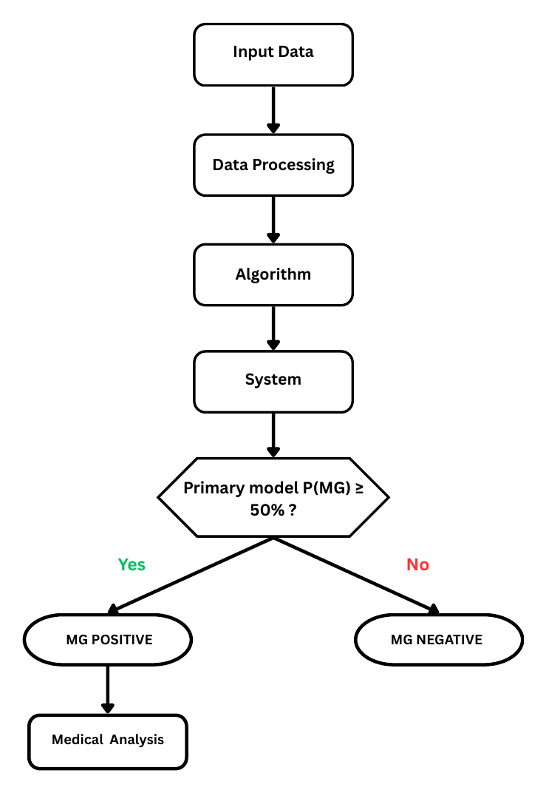

# Architecture

MyaScreen has three parts: a React front end, a Flask API, and an offline training pipeline. The API loads the trained models at start-up; nothing is trained when a patient is screened.



## Request flow

1. **Input.** The five-step form collects patient details, 17 MG-specific signs, 13 general symptoms, 5 history items and optional blood values and antibody status. If swallowing or breathing difficulty is ticked, an urgent banner appears immediately in the browser. "Generate report" sends one JSON request to `POST /predict`.
2. **Validation.** `api.py` and `MGPredictor` reject unknown keys and out-of-range values with HTTP 400, ignore blank blood fields, compare each blood value with its sex-specific reference range (Low / Normal / High) and convert ticked items into 0/1.
3. **Feature vector.** 47 numbers in the training column order: 17 MG signs, 18 general-symptom and history items, 9 blood flags, plus age, sex and symptom duration in months. Blood group is printed on the report but is deliberately not a model input.
4. **Scoring.** The five models score the same vector. Platt scaling (fitted on out-of-fold scores) converts each score to P(MG).
5. **Decision.** The primary model, chosen as the one with the highest five-fold cross-validated ROC-AUC on the development set, decides POSITIVE at P(MG) >= 50%. The other four are reported alongside it and do not vote.
6. **Report.** `mg/predictor.py` builds the result; `mg/knowledge.py` adds rule-based investigations, specialists and advice (guidance, not model output). A NEGATIVE result still gets a full report with a watch-list.
7. **Hospital finder (optional).** If a South Chennai area or GPS position is supplied, `mg/hospitals.py` adds the nearest hospital (smallest straight-line distance) and the best-evidenced hospital (documented scoring rule, see `HOSPITALS.md`). It runs after the prediction and never changes it.
8. **PDF.** `POST /report-pdf` renders the same report with ReportLab (`mg/report_pdf.py`), so the browser needs no PDF library.



*The diagrams show the core prediction path. The offline training pipeline, the PDF download, the hospital finder and the HTTP 400 error path are described above but not drawn.*

## Training pipeline

```
generate_dataset.py  ->  data/mg_screening_dataset.csv   (8,000 simulated patients, seed 42)
train.py             ->  stratified 80/20 split
                         5-fold out-of-fold scores on the development set -> Platt calibrators + thresholds
                         final fit on the development set, single evaluation on the untouched test set
                         models/mg_bundle.joblib, outputs/*.png, metrics.csv/json, learning_curve.json
```

## The algorithms

| Model | Setting |
|---|---|
| Gaussian Naive Bayes | independence assumption over the features |
| Decision Tree | max depth 5, at least 50 patients per leaf |
| Linear Regression | used as a linear probability model on standardised inputs |
| Logistic Regression | standardised inputs, balanced class weights (shipped primary model) |
| Random Forest | 300 trees, max depth 8, at least 20 patients per leaf |

## Keeping the two halves in sync

- Symptom keys live in `backend/mg_predictor/mg/config.py` and are mirrored in `src/lib/mg-options.ts`; a test fails if they drift.
- `src/lib/mg-api.ts` mirrors the response shape built in `mg/predictor.py`. Change both together.
- Hospital areas live in `mg/hospitals.py` and `src/lib/mg-locations.ts`; a test checks that they agree.
